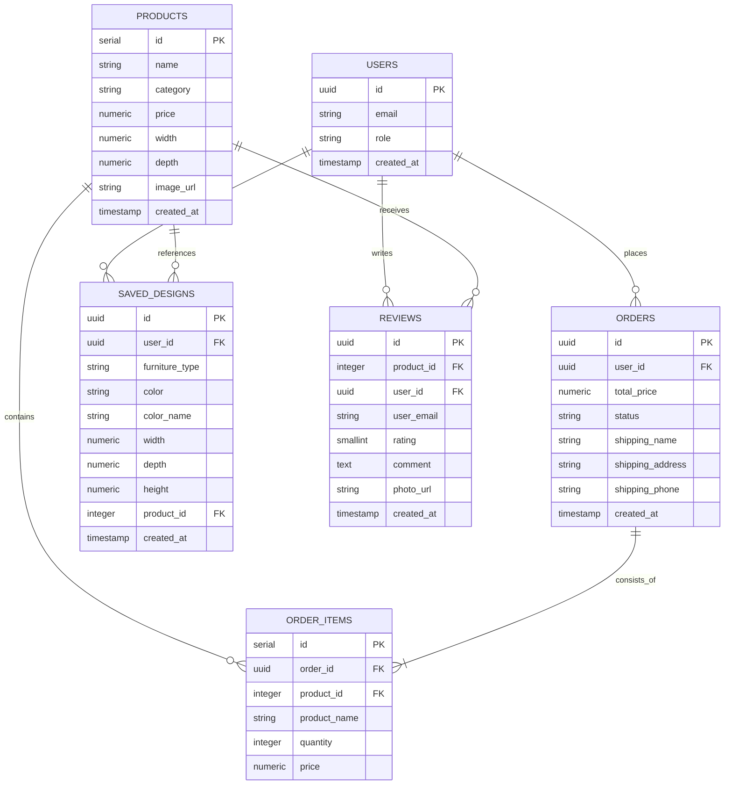

# บทที่ 3
# การวิเคราะห์และออกแบบระบบ (System Analysis and Design)
### โครงงาน: ระบบร้านเฟอร์นิเจอร์ไม้แท้สั่งผลิตพร้อมระบบจำลอง 3 มิติ (MINIM Furniture Web Application)
**หลักสูตรวิทยาศาสตรบัณฑิต สาขาวิชาวิทยาการข้อมูลและนวัตกรรมซอฟต์แวร์ มหาวิทยาลัยอุบลราชธานี**

---

ในบทนี้จะกล่าวถึงการวิเคราะห์และออกแบบระบบร้านเฟอร์นิเจอร์ไม้แท้สั่งผลิต (MINIM Furniture) ซึ่งการวิเคราะห์และการออกแบบระบบที่ใช้ในการพัฒนาจะแบ่งออกเป็นหัวข้อหลักดังนี้:
- 3.1 โครงสร้างภาพรวมของระบบ (System Architecture)
- 3.2 ความต้องการของระบบ (System Requirements)
- 3.3 การออกแบบส่วนติดต่อกับผู้ใช้ (User Interface Design)
- 3.4 แผนภาพยูสเคส (Use Case Diagram) และคำอธิบายยูสเคส (Use Case Descriptions)
- 3.5 การออกแบบฐานข้อมูล (Entity Relationship Diagram: ERD)
- 3.6 พจนานุกรมข้อมูล (Data Dictionary)

---

## 3.1 โครงสร้างภาพรวมของระบบ (System Architecture)

ระบบ MINIM Furniture ออกแบบสถาปัตยกรรมแบบ Modern Decoupled Web Architecture โดยแยกส่วนการแสดงผล (Client-side Frontend) และส่วนบริการข้อมูลหลังบ้าน (Backend-as-a-Service: BaaS) ออกจากกันอย่างเป็นอิสระ:
1. **Client (Frontend):** พัฒนาด้วย React 19 ทำงานบน Vite ควบคู่กับ Three.js (@react-three/fiber) สำหรับการประมวลผลเรนเดอร์กราฟิก 3 มิติบน WebGL ของเบราว์เซอร์ผู้ใช้โดยตรง
2. **Backend & Database (BaaS):** ใช้บริการ Supabase (PostgreSQL Database Engine) ทำหน้าที่จัดการ Authentication, จัดเก็บข้อมูลเชิงสัมพันธ์, จัดเก็บไฟล์รูปภาพรีวิว (Storage Bucket) และประมวลผลคำสั่งซื้อแบบ Atomic ผ่าน Remote Procedure Call (RPC)
3. **Security Layer:** ควบคุมความปลอดภัยของข้อมูลในระดับแถวด้วย Row Level Security (RLS) และ Role-Based Access Control (RBAC)

---

## 3.2 ความต้องการของระบบ (System Requirements)

### 3.2.1 ความต้องการเชิงฟังก์ชัน (Functional Requirements)
ระบบแบ่งกลุ่มผู้ใช้งานออกเป็น 2 กลุ่มหลัก ได้แก่:

#### 1. ลูกค้า / ผู้ใช้งานทั่วไป (Customer / User)
- สามารถลงทะเบียนสมัครสมาชิกและเข้าสู่ระบบได้
- สามารถค้นหา กรองหมวดหมู่ และเลือกชมสินค้าเฟอร์นิเจอร์ไม้แท้ได้
- สามารถดูรายละเอียดสินค้าแบบด่วน (Quick View) และอ่านรีวิวสินค้าได้
- สามารถออกแบบและปรับแต่งโมเดล 3 มิติ (เลือกชนิดไม้, ปรับขนาดกว้าง/ยาว/สูง) และคำนวณราคาแบบเรียลไทม์
- สามารถบันทึกแบบจำลอง 3 มิติเก็บไว้ในโปรไฟล์ส่วนตัวเพื่อเรียกดูซ้ำได้
- สามารถจัดการตะกร้าสินค้า (เพิ่ม/ลดจำนวน, ลบรายการ) และบันทึกสินค้าที่ถูกใจ (Wishlist)
- สามารถสั่งซื้อสินค้าและเลือกวิธีการชำระเงิน (PromptPay, COD, บัตรเครดิต)
- สามารถตรวจสอบประวัติการสั่งซื้อและสถานะการจัดส่งสินค้าได้
- สามารถเขียนรีวิว ให้คะแนนดาว และอัปโหลดภาพถ่ายสินค้าจริงได้

#### 2. ผู้ดูแลระบบ (Admin)
- สามารถเข้าสู่ระบบหลังบ้านด้วยสิทธิ์ผู้ดูแลระบบ (Role-Based Admin)
- สามารถจัดการรายการสินค้าหน้าร้านได้ครบวงจร (CRUD: เพิ่ม, ลบ, แก้ไขสินค้า พร้อม Live Preview รูปภาพ)
- สามารถตรวจสอบรายการคำสั่งซื้อของลูกค้าทั้งหมด ค้นหาตามชื่อผู้รับหรือรหัสคำสั่งซื้อ
- สามารถปรับเปลี่ยนสถานะคำสั่งซื้อได้ (รอดำเนินการ, กำลังเตรียมของ, จัดส่งแล้ว, จัดส่งสำเร็จ, ยกเลิก)

---

## 3.4 แผนภาพยูสเคสและคำอธิบาย (Use Case Diagram & Descriptions)

### ตารางที่ 3.1: สัญลักษณ์ของ Use Case Diagram (ตามมาตรฐาน UML)
| สัญลักษณ์ | คำอธิบาย |
| :---: | :--- |
| **Actor** | บุคคลหรือบทบาทผู้ใช้งานภายนอกระบบ แทนด้วยรูปคน |
| **Use Case** | ส่วนย่อยของระบบงานหรือฟังก์ชัน แทนด้วยวงรีพร้อมชื่อฟังก์ชัน |
| **System Boundary** | กรอบสี่เหลี่ยมแสดงขอบเขตของระบบ โดย Use Case จะอยู่ภายในกรอบ |
| **Association Line** | เส้นตรงแสดงการมีปฏิสัมพันธ์ระหว่าง Actor กับ Use Case |
| **<< include >>** | ความสัมพันธ์ที่ Use Case หลักต้องเรียกใช้งาน Use Case ย่อยเสมอ |
| **<< extend >>** | ความสัมพันธ์ที่ Use Case หนึ่งเป็นทางเลือกส่วนขยายของอีก Use Case หนึ่ง |

---

### ตารางที่ 3.2: อธิบาย Use Case หน้าที่ของระบบโดยรวม
| ลำดับ | Use Case (ภาษาไทย) | Use Case (ภาษาอังกฤษ) | คำอธิบายหน้าที่การทำงาน |
| :---: | :--- | :--- | :--- |
| 1 | สมัครสมาชิก | Register | ผู้ใช้ทั่วไปสามารถลงทะเบียนเปิดบัญชีผู้ใช้ใหม่ในระบบได้ |
| 2 | เข้าสู่ระบบ | Login | สมาชิกและแอดมินสามารถยืนยันตัวตนเข้าสู่ระบบด้วยอีเมลและรหัสผ่าน |
| 3 | ค้นหาและดูแคตตาล็อกสินค้า | Browse & Search Products | ค้นหาชื่อสินค้าและกรองสินค้าตามหมวดหมู่ห้องเฟอร์นิเจอร์ไม้แท้ |
| 4 | ดูรายละเอียดสินค้าด่วน | Quick View Product | แสดงหน้าต่างป๊อปอัปรายละเอียด สัดส่วน วัสดุ และรีวิวของสินค้า |
| 5 | จัดการรายการสินค้าโปรด | Manage Wishlist | บันทึกสินค้าที่ชื่นชอบเก็บไว้ในรายการโปรด และสามารถลบออกได้ |
| 6 | ออกแบบโมเดล 3 มิติ | 3D Customizer | ปรับขนาด สลับสีเนื้อไม้ และประเมินราคาชิ้นงานสั่งทำแบบเรียลไทม์ |
| 7 | บันทึกแบบจำลอง 3D | Save 3D Design | จัดเก็บสัดส่วนและพารามิเตอร์ของโมเดล 3D ลงในบัญชีผู้ใช้ |
| 8 | จัดการตะกร้าสินค้า | Manage Cart | เพิ่มสินค้าเข้าตะกร้า ปรับเพิ่ม/ลดจำนวน และคำนวณราคารวม |
| 9 | สั่งซื้อและชำระเงิน | Checkout & Place Order | กรอกข้อมูลจัดส่ง เลือกวิธีชำระเงิน และบันทึกคำสั่งซื้อผ่าน RPC |
| 10 | ตรวจสอบข้อมูลส่วนตัวและออร์เดอร์ | View Profile & Orders | ตรวจสอบประวัติการสั่งซื้อ สถานะพัสดุ และแบบจำลอง 3D ที่บันทึกไว้ |
| 11 | เขียนรีวิวพร้อมแนบรูปถ่าย | Product Review & Photo | ให้คะแนน 1-5 ดาว เขียนข้อความ และอัปโหลดภาพจริงขึ้น Cloud Storage |
| 12 | จัดการสินค้าหน้าร้าน (CRUD) | Manage Products (CRUD) | แอดมินสามารถเพิ่ม แก้ไขราคา/รูปภาพ และลบสินค้าออกจากระบบ |
| 13 | จัดการสถานะคำสั่งซื้อ | Manage Order Status | แอดมินตรวจสอบรายละเอียดออร์เดอร์และอัปเดตสถานะการจัดส่ง |

---

### ตารางคำอธิบาย Use Case รายข้อ (Use Case Specifications)

#### ตารางที่ 3.3: Use Case สมัครสมาชิก
| รายการ | รายละเอียด |
| :--- | :--- |
| **Use Case Title** | สมัครสมาชิก (Register) |
| **Use Case ID** | UC-01 |
| **Primary Actor** | ผู้ใช้ทั่วไป (Guest / User) |
| **Stakeholder Actor** | - |
| **Main Flow** | 1. ผู้ใช้กดปุ่มเข้าสู่ระบบ แล้วเลือก "สมัครสมาชิกเลย" 2. ผู้ใช้กรอก อีเมล (Email) และ รหัสผ่าน (Password อย่างน้อย 6 ตัวอักษร) 3. ผู้ใช้กดปุ่ม "สมัครสมาชิก" 4. ระบบส่งข้อมูลไปยัง Supabase Auth เพื่อสร้างบัญชีผู้ใช้ใหม่ 5. ระบบเข้าสู่ระบบให้อัตโนมัติและแสดงข้อความแจ้งเตือนสำเร็จ |
| **Exceptional Flow** | **Flow 1:** กรณีกรอกอีเมลไม่ถูกต้องตามรูปแบบ ระบบแจ้งเตือน "กรุณากรอกอีเมลให้ถูกต้อง" **Flow 2:** กรณีรหัสผ่านสั้นกว่า 6 ตัวอักษร ระบบแจ้งเตือน "Password ต้องมีความยาวอย่างน้อย 6 ตัวอักษร" **Flow 3:** กรณีอีเมลมีอยู่ในระบบแล้ว ระบบแจ้งเตือน "อีเมลนี้ถูกใช้งานแล้ว" |

#### ตารางที่ 3.4: Use Case เข้าสู่ระบบ
| รายการ | รายละเอียด |
| :--- | :--- |
| **Use Case Title** | เข้าสู่ระบบ (Login) |
| **Use Case ID** | UC-02 |
| **Primary Actor** | สมาชิก / ผู้ดูแลระบบ (User / Admin) |
| **Stakeholder Actor** | - |
| **Main Flow** | 1. ผู้ใช้กดไอคอนโปรไฟล์เพื่อเปิดหน้าต่างเข้าสู่ระบบ 2. ผู้ใช้กรอก อีเมล และ รหัสผ่าน ที่ลงทะเบียนไว้ 3. ผู้ใช้กดปุ่ม "เข้าสู่ระบบ" 4. ระบบตรวจสอบสิทธิ์ผ่าน Supabase Auth (`signInWithPassword`) 5. หากเป็น Admin ระบบจะเปิดสิทธิ์การแสดงผลไอคอนโล่ 🛡️ แอดมินบน Navbar 6. ระบบแจ้งเตือนเข้าสู่ระบบสำเร็จ |
| **Exceptional Flow** | **Flow 1:** กรอกอีเมลหรือรหัสผ่านผิด ระบบแจ้งเตือน "อีเมลหรือรหัสผ่านไม่ถูกต้อง" **Flow 2:** ไม่ได้กรอกข้อมูลช่องใดช่องหนึ่ง ระบบแจ้งเตือนให้กรอกข้อมูลให้ครบ |

#### ตารางที่ 3.5: Use Case ค้นหาและดูแคตตาล็อกสินค้า
| รายการ | รายละเอียด |
| :--- | :--- |
| **Use Case Title** | ค้นหาและดูแคตตาล็อกสินค้า (Browse & Search Products) |
| **Use Case ID** | UC-03 |
| **Primary Actor** | ลูกค้า / ผู้ใช้งานทั่วไป |
| **Stakeholder Actor** | - |
| **Main Flow** | 1. ผู้ใช้เข้าสู่หน้าหลักของเว็บไซต์ (Shop View) 2. ระบบดึงข้อมูลสินค้าไม้แท้จากตาราง `products` มาแสดงผล 3. ผู้ใช้พิมพ์คำค้นหาในช่อง Search หรือกดเลือกหมวดหมู่ห้อง (Living Room, Bedroom, Office) 4. ระบบกรองรายการสินค้าที่ตรงตามเงื่อนไขแสดงผลแบบ Real-time |
| **Exceptional Flow** | **Flow 1:** ไม่พบสินค้าที่ตรงกับคำค้นหา ระบบแสดงข้อความ "ไม่พบสินค้าที่ตรงกับการค้นหา" |

#### ตารางที่ 3.6: Use Case ออกแบบโมเดล 3 มิติ (Innovation)
| รายการ | รายละเอียด |
| :--- | :--- |
| **Use Case Title** | ออกแบบโมเดล 3 มิติ (3D Furniture Customizer) |
| **Use Case ID** | UC-06 |
| **Primary Actor** | ลูกค้า / ผู้ใช้งานทั่วไป |
| **Stakeholder Actor** | - |
| **Main Flow** | 1. ผู้ใช้คลิกเมนู "ออกแบบ 3D" บนแถบนำทาง Navbar 2. ระบบแสดง Canvas 3D เรนเดอร์โมเดลไม้ตามค่าเริ่มต้น 3. ผู้ใช้เลือกประเภทเฟอร์นิเจอร์ (โต๊ะ, เก้าอี้, ตู้, ชั้นวางรองเท้า) 4. ผู้ใช้ปรับแถบเลื่อนขนาด (กว้าง, ลึก, สูง) และเลือกสีลายไม้ (Oak, Walnut, Ash) 5. ระบบคำนวณปริมาตรไม้และปรับราคาประเมินแบบ Real-time 6. ผู้ใช้กดปุ่ม "สั่งทำชิ้นนี้" เพื่อส่งชิ้นงานเข้าสู่ตะกร้าสินค้า |
| **Exceptional Flow** | - |

#### ตารางที่ 3.7: Use Case สั่งซื้อและชำระเงิน
| รายการ | รายละเอียด |
| :--- | :--- |
| **Use Case Title** | สั่งซื้อและชำระเงิน (Checkout & Place Order) |
| **Use Case ID** | UC-09 |
| **Primary Actor** | สมาชิก (Authenticated Customer) |
| **Stakeholder Actor** | พนักงานจัดส่งสินค้า |
| **Main Flow** | 1. ผู้ใช้เปิดตะกร้าสินค้าและกดปุ่ม "ดำเนินการสั่งซื้อ" 2. ระบบแสดงหน้าต่าง Checkout Modal 3. ผู้ใช้กรอกชื่อ-นามสกุล, ที่อยู่จัดส่ง, เบอร์โทรศัพท์ และเลือกวิธีชำระเงิน 4. ผู้ใช้กดยืนยันคำสั่งซื้อ 5. ระบบเรียกฟังก์ชัน RPC `place_order` บันทึกตาราง `orders` และ `order_items` พร้อมกันแบบ Atomic Transaction 6. ระบบล้างตะกร้าสินค้าและแจ้งเตือนสั่งซื้อสำเร็จ |
| **Exceptional Flow** | **Flow 1:** ผู้ใช้ยังไม่ได้เข้าสู่ระบบ ระบบแสดงข้อความแจ้งเตือน "กรุณาเข้าสู่ระบบก่อนทำการสั่งซื้อ" **Flow 2:** ข้อมูลที่อยู่หรือเบอร์โทรศัพท์ว่างเปล่า ระบบแจ้งเตือนให้กรอกข้อมูลบังคับให้ครบถ้วน |

#### ตารางที่ 3.8: Use Case เขียนรีวิวสินค้าพร้อมแนบรูปถ่าย
| รายการ | รายละเอียด |
| :--- | :--- |
| **Use Case Title** | เขียนรีวิวสินค้าพร้อมแนบรูปถ่าย (Review & Upload Photo) |
| **Use Case ID** | UC-11 |
| **Primary Actor** | สมาชิก (Authenticated Customer) |
| **Stakeholder Actor** | - |
| **Main Flow** | 1. ผู้ใช้กดดูรายละเอียดสินค้า (Quick View) ในสินค้าชิ้นที่ต้องการ 2. ผู้ใช้เลือกให้คะแนนดาว (1-5 ดาว) และพิมพ์ข้อความความคิดเห็น 3. ผู้ใช้กดเลือกไฟล์ภาพถ่ายสินค้าจริงจากเครื่อง (ไม่เกิน 5 MB) 4. ระบบอัปโหลดไฟล์รูปภาพเข้าสู่ Supabase Storage Bucket `review-photos` 5. ระบบบันทึกข้อมูลรีวิวลงตาราง `reviews` และแสดงผลรีวิวใหม่ทันที |
| **Exceptional Flow** | **Flow 1:** ผู้ใช้ยังไม่ได้ล็อกอิน ระบบแจ้งเตือนให้เข้าสู่ระบบก่อนรีวิว **Flow 2:** ไฟล์ภาพมีขนาดเกิน 5 MB ระบบแจ้งเตือนปฏิเสธไฟล์ |

#### ตารางที่ 3.9: Use Case จัดการสินค้าหน้าร้าน (CRUD)
| รายการ | รายละเอียด |
| :--- | :--- |
| **Use Case Title** | จัดการสินค้าหน้าร้าน (Manage Products CRUD) |
| **Use Case ID** | UC-12 |
| **Primary Actor** | ผู้ดูแลระบบ (Admin) |
| **Stakeholder Actor** | - |
| **Main Flow** | 1. แอดมินกดไอคอนโล่ 🛡️ เพื่อเข้าสู่หน้าแอดมินแดชบอร์ด 2. ระบบแสดงตารางรายการสินค้าทั้งหมดพร้อมปุ่มจัดการ 3. **กรณีเพิ่ม/แก้ไข:** แอดมินกดปุ่มเพิ่มหรือแก้ไข กรอกชื่อ หมวดหมู่ ราคา ขนาด และ URL รูปภาพ (มีระบบ Live Preview แสดงผลทันที) 4. แอดมินกด "บันทึกข้อมูล" ระบบอัปเดตฐานข้อมูลตาราง `products` 5. **กรณีลบ:** แอดมินกดไอคอนถังขยะและยืนยันการลบ ระบบจะลบสินค้าออกจากฐานข้อมูลทันที |
| **Exceptional Flow** | **Flow 1:** แอดมินเผลอใส่ Path ไฟล์ในเครื่อง (C:\...) ระบบจะแจ้งเตือนเตือนว่าต้องใช้ URL ออนไลน์เท่านั้น |

#### ตารางที่ 3.10: Use Case จัดการสถานะคำสั่งซื้อ
| รายการ | รายละเอียด |
| :--- | :--- |
| **Use Case Title** | จัดการสถานะคำสั่งซื้อ (Manage Order Status) |
| **Use Case ID** | UC-13 |
| **Primary Actor** | ผู้ดูแลระบบ (Admin) |
| **Stakeholder Actor** | ลูกค้า |
| **Main Flow** | 1. แอดมินเลือกแท็บ "📋 จัดการคำสั่งซื้อ (Orders)" ในหน้าแอดมิน 2. ระบบแสดงรายการคำสั่งซื้อทั้งหมดของลูกค้า เรียงจากล่าสุด 3. แอดมินสามารถคลิกดูรายการสินค้าภายในออร์เดอร์และที่อยู่จัดส่ง 4. แอดมินเลือกเปลี่ยนสถานะในดรอปดาวน์ (Pending ➔ Processing ➔ Shipped ➔ Delivered) 5. ระบบอัปเดตฟิลด์ `status` ในตาราง `orders` ทันที |
| **Exceptional Flow** | - |

---

## 3.5 การออกแบบฐานข้อมูล (Entity Relationship Diagram)

โครงสร้างฐานข้อมูลเชิงสัมพันธ์ของระบบ MINIM Furniture ออกแบบบนฐานข้อมูล PostgreSQL (Supabase) มีความสัมพันธ์ของตารางหลักดังนี้:

---

## 3.6 พจนานุกรมข้อมูล (Data Dictionary)

### ตารางที่ 3.11: รายละเอียด Entity ที่เกี่ยวข้องกับระบบ MINIM Furniture
| ชื่อตาราง (ภาษาไทย) | ชื่อตาราง (ภาษาอังกฤษ) | รหัสตาราง | คำอธิบาย |
| :--- | :--- | :---: | :--- |
| ผู้ใช้งานระบบ | users (auth.users) | D1 | จัดเก็บข้อมูลบัญชีผู้ใช้ สิทธิ์บทบาท (User/Admin) ผ่านระบบ Supabase Auth |
| สินค้าเฟอร์นิเจอร์ | products | D2 | จัดเก็บข้อมูลสินค้าไม้แท้ ราคา หมวดหมู่ห้อง สัดส่วน และลิงก์รูปภาพ |
| คำสั่งซื้อ | orders | D3 | จัดเก็บข้อมูลหัวบิลคำสั่งซื้อ ยอดชำระรวม ข้อมูลจัดส่ง และสถานะคำสั่งซื้อ |
| รายการสินค้าในคำสั่งซื้อ | order_items | D4 | จัดเก็บรายการย่อยของสินค้าแต่ละชิ้นในคำสั่งซื้อ (รองรับทั้งสินค้าปกติและ 3D Custom) |
| แบบจำลอง 3 มิติที่บันทึก | saved_designs | D5 | จัดเก็บพารามิเตอร์ของโมเดล 3D ที่ผู้ใช้ปรับแต่งและกดบันทึกไว้ในบัญชี |
| รีวิวและความคิดเห็น | reviews | D6 | จัดเก็บคะแนนดาว ข้อความรีวิว และ URL ภาพถ่ายสินค้าจริงของผู้ใช้ |

---

### พจนานุกรมข้อมูลรายตาราง (Data Dictionary Specifications)

#### ตารางที่ 3.12: พจนานุกรมตาราง สินค้าเฟอร์นิเจอร์ (products: D2)
| Data Item | Data Type | Data Size | PK | FK | คำอธิบาย |
| :--- | :--- | :---: | :---: | :---: | :--- |
| id | serial | 4 | ✓ | - | รหัสสินค้าประจำตัว (Auto Increment) |
| name | varchar | 255 | - | - | ชื่อสินค้าเฟอร์นิเจอร์ไม้แท้ |
| category | varchar | 100 | - | - | หมวดหมู่การใช้งาน (Living Room, Bedroom, Office) |
| price | numeric | 10,2 | - | - | ราคาจำหน่ายฐานของสินค้า ($ / คำนวณเป็น ฿) |
| width | numeric | 5,2 | - | - | สัดส่วนความกว้างของสินค้า (สเกล 1 = 10 ซม.) |
| depth | numeric | 5,2 | - | - | สัดส่วนความลึกของสินค้า (สเกล 1 = 10 ซม.) |
| image_url | text | - | - | - | ลิงก์ URL รูปภาพสินค้าคุณภาพสูง |
| created_at | timestamptz | 8 | - | - | วันที่และเวลาที่เพิ่มสินค้าเข้าสู่ระบบ |

#### ตารางที่ 3.13: พจนานุกรมตาราง คำสั่งซื้อ (orders: D3)
| Data Item | Data Type | Data Size | PK | FK | คำอธิบาย |
| :--- | :--- | :---: | :---: | :---: | :--- |
| id | uuid | 16 | ✓ | - | รหัสคำสั่งซื้อแบบสากล (UUID v4) |
| user_id | uuid | 16 | - | ✓ | รหัสผู้ใช้งานที่ทำรายการสั่งซื้อ (อ้างอิง auth.users) |
| total_price | numeric | 10,2 | - | - | ยอดเงินรวมสุทธิของคำสั่งซื้อ |
| status | varchar | 50 | - | - | สถานะคำสั่งซื้อ (pending, processing, shipped, delivered) |
| shipping_name | text | - | - | - | ชื่อ-นามสกุลของผู้รับสินค้า |
| shipping_address | text | - | - | - | ที่อยู่จัดส่งโดยละเอียดของผู้รับ |
| shipping_phone | varchar | 20 | - | - | เบอร์โทรศัพท์ติดต่อสำหรับพนักงานขนส่ง |
| created_at | timestamptz | 8 | - | - | วันที่และเวลาที่สั่งซื้อ |

#### ตารางที่ 3.14: พจนานุกรมตาราง รายการสินค้าในคำสั่งซื้อ (order_items: D4)
| Data Item | Data Type | Data Size | PK | FK | คำอธิบาย |
| :--- | :--- | :---: | :---: | :---: | :--- |
| id | serial | 4 | ✓ | - | รหัสรายการสินค้าในออร์เดอร์ |
| order_id | uuid | 16 | - | ✓ | รหัสคำสั่งซื้อหลักที่สังกัด (อ้างอิง orders.id) |
| product_id | integer | 4 | - | ✓ | รหัสสินค้า (กรณีเป็น 3D Custom จะมีค่าเป็น NULL) |
| product_name | text | - | - | - | ชื่อสินค้าหรือชื่อสเปกโมเดล 3D ที่สั่งผลิต |
| quantity | integer | 4 | - | - | จำนวนชิ้นที่สั่งซื้อ |
| price | numeric | 10,2 | - | - | ราคาต่อหน่วย ณ ขณะสั่งซื้อ |

#### ตารางที่ 3.15: พจนานุกรมตาราง แบบจำลอง 3 มิติที่บันทึก (saved_designs: D5)
| Data Item | Data Type | Data Size | PK | FK | คำอธิบาย |
| :--- | :--- | :---: | :---: | :---: | :--- |
| id | uuid | 16 | ✓ | - | รหัสชิ้นงานออกแบบ 3D |
| user_id | uuid | 16 | - | ✓ | รหัสเจ้าของแบบจำลอง (อ้างอิง auth.users) |
| furniture_type | varchar | 50 | - | - | ประเภทเฟอร์นิเจอร์ (table, chair, cupboard, shoerack) |
| color | varchar | 20 | - | - | รหัสโค้ดสีเนื้อไม้ที่เลือก (Hex Color) |
| color_name | varchar | 50 | - | - | ชื่อชนิดเนื้อไม้ (Oak, Walnut, Ash) |
| width | numeric | 5,2 | - | - | ขนาดความกว้างที่กำหนด (หน่วยสเกล) |
| depth | numeric | 5,2 | - | - | ขนาดความลึกที่กำหนด (หน่วยสเกล) |
| height | numeric | 5,2 | - | - | ขนาดความสูงที่กำหนด (หน่วยสเกล) |
| product_id | integer | 4 | - | ✓ | รหัสสินค้าอ้างอิงต้นแบบ (ถ้ามี) |
| created_at | timestamptz | 8 | - | - | วันที่บันทึกแบบจำลอง |

#### ตารางที่ 3.16: พจนานุกรมตาราง รีวิวและความคิดเห็น (reviews: D6)
| Data Item | Data Type | Data Size | PK | FK | คำอธิบาย |
| :--- | :--- | :---: | :---: | :---: | :--- |
| id | uuid | 16 | ✓ | - | รหัสข้อความรีวิว |
| product_id | integer | 4 | - | ✓ | รหัสสินค้าที่ถูกรีวิว (อ้างอิง products.id) |
| user_id | uuid | 16 | - | ✓ | รหัสผู้เขียนรีวิว (อ้างอิง auth.users) |
| user_email | varchar | 255 | - | - | อีเมลของผู้เขียนรีวิว (สำหรับแสดงชื่อผู้รีวิว) |
| rating | smallint | 2 | - | - | คะแนนความพึงพอใจ (1 ถึง 5 ดาว) |
| comment | text | - | - | - | ข้อความแสดงความคิดเห็นต่อสินค้า |
| photo_url | text | - | - | - | URL ไฟล์ภาพถ่ายจริงใน Supabase Storage Bucket |
| created_at | timestamptz | 8 | - | - | วันที่และเวลาที่เขียนรีวิว |
