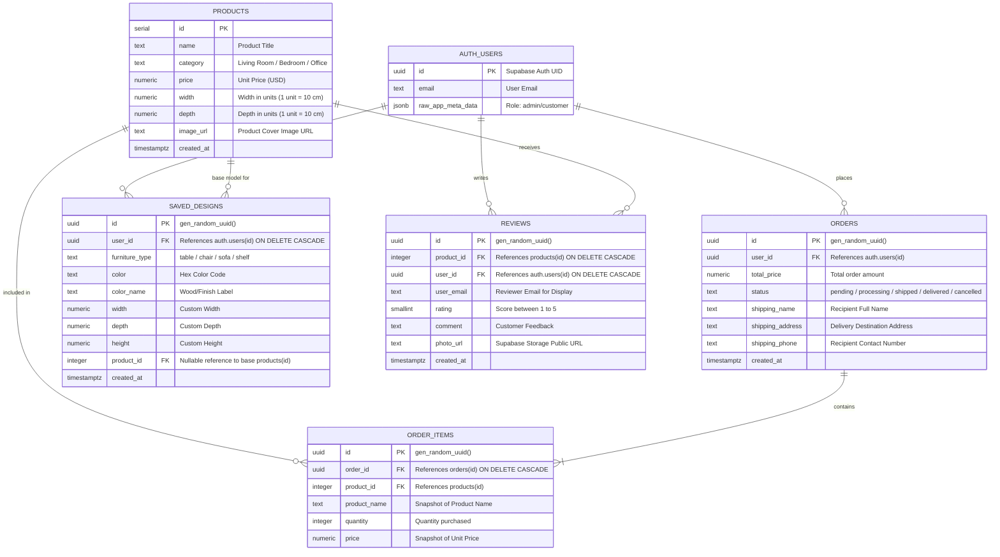

# บทที่ 3 — การออกแบบฐานข้อมูล (Database Modeling & ER Diagram)
### โครงงาน: MINIM Furniture — Minimalist Furniture E-Commerce with 3D Customizer

---

## 1. ผังความสัมพันธ์ข้อมูล (Entity-Relationship Diagram: ERD)

---

## 2. พจนานุกรมข้อมูล (Data Dictionary)

### 2.1 ตาราง `products` (สินค้า)
| ฟิลด์ (Field) | ชนิดข้อมูล (Data Type) | คีย์ (Key) | คำอธิบาย (Description) |
|---|---|---|---|
| `id` | SERIAL | PK | รหัสสินค้าประจำรายการ |
| `name` | TEXT | | ชื่อสินค้า |
| `category` | TEXT | | หมวดหมู่สินค้า (เช่น Living Room, Bedroom, Office) |
| `price` | NUMERIC(10,2) | | ราคาสินค้า |
| `width` | NUMERIC | | ความกว้างของสินค้า (สเกล 1 หน่วย = 10 ซม.) |
| `depth` | NUMERIC | | ความลึกของสินค้า (สเกล 1 หน่วย = 10 ซม.) |
| `image_url` | TEXT | | ลิงก์ URL รูปภาพสินค้า |
| `created_at` | TIMESTAMPTZ | | วันที่และเวลาที่เพิ่มสินค้า |

### 2.2 ตาราง `orders` (คำสั่งซื้อ)
| ฟิลด์ (Field) | ชนิดข้อมูล (Data Type) | คีย์ (Key) | คำอธิบาย (Description) |
|---|---|---|---|
| `id` | UUID | PK | รหัสประจำคำสั่งซื้อ (Auto gen_random_uuid) |
| `user_id` | UUID | FK | รหัสผู้สั่งซื้อ เชื่อมโยงกับ `auth.users(id)` |
| `total_price` | NUMERIC(10,2) | | ยอดรวมของคำสั่งซื้อ |
| `status` | TEXT | | สถานะ: `pending`, `processing`, `shipped`, `delivered`, `cancelled` |
| `shipping_name`| TEXT | | ชื่อ-นามสกุล ผู้รับพัสดุ |
| `shipping_address`| TEXT | | ที่อยู่จัดส่ง |
| `shipping_phone`| TEXT | | หมายเลขโทรศัพท์ติดต่อ |
| `created_at` | TIMESTAMPTZ | | วันที่และเวลาที่สั่งซื้อ |

### 2.3 ตาราง `order_items` (รายการสินค้าในคำสั่งซื้อ)
| ฟิลด์ (Field) | ชนิดข้อมูล (Data Type) | คีย์ (Key) | คำอธิบาย (Description) |
|---|---|---|---|
| `id` | UUID | PK | รหัสรายการสินค้าในออร์เดอร์ |
| `order_id` | UUID | FK | รหัสออร์เดอร์ เชื่อมโยง `orders(id)` (ON DELETE CASCADE) |
| `product_id` | INTEGER | FK | รหัสสินค้า เชื่อมโยง `products(id)` (Nullable สำหรับ custom) |
| `product_name`| TEXT | | ชื่อสินค้า ณ เวลาสั่งซื้อ (Snapshot ป้องกันการเปลี่ยนแปลงชื่อภายหลัง) |
| `quantity` | INTEGER | | จำนวนชิ้นที่สั่งซื้อ |
| `price` | NUMERIC(10,2) | | ราคาต่อหน่วย ณ เวลาสั่งซื้อ |

### 2.4 ตาราง `saved_designs` (แบบ 3D ที่บันทึกไว้)
| ฟิลด์ (Field) | ชนิดข้อมูล (Data Type) | คีย์ (Key) | คำอธิบาย (Description) |
|---|---|---|---|
| `id` | UUID | PK | รหัสประจำแบบจำลอง |
| `user_id` | UUID | FK | รหัสผู้ใช้เจ้าของแบบ เชื่อม `auth.users(id)` |
| `furniture_type`| TEXT | | ประเภทของเฟอร์นิเจอร์ (เช่น table, chair) |
| `color` | TEXT | | รหัสสี Hex ของวัสดุ |
| `color_name` | TEXT | | ชื่อเรียกของเฉดสี/เนื้อไม้ (เช่น Natural Oak) |
| `width` | NUMERIC | | ค่าความกว้างที่กำหนดเอง |
| `depth` | NUMERIC | | ค่าความลึกที่กำหนดเอง |
| `height` | NUMERIC | | ค่าความสูงที่กำหนดเอง |
| `product_id` | INTEGER | FK | รหัสสินค้าอ้างอิงต้นแบบ (ถ้ามี) |
| `created_at` | TIMESTAMPTZ | | วันที่และเวลาที่บันทึก |

### 2.5 ตาราง `reviews` (รีวิวสินค้า)
| ฟิลด์ (Field) | ชนิดข้อมูล (Data Type) | คีย์ (Key) | คำอธิบาย (Description) |
|---|---|---|---|
| `id` | UUID | PK | รหัสรีวิว |
| `product_id` | INTEGER | FK | รหัสสินค้าที่ถูกรีวิว เชื่อม `products(id)` |
| `user_id` | UUID | FK | รหัสผู้เขียนรีวิว เชื่อม `auth.users(id)` |
| `user_email` | TEXT | | อีเมลผู้เขียนรีวิว (ใช้สำหรับแสดงผลผู้รีวิว) |
| `rating` | SMALLINT | | คะแนนดาว (1 - 5) |
| `comment` | TEXT | | ข้อความรีวิว |
| `photo_url` | TEXT | | URL รูปภาพประกอบรีวิว (เก็บบน Supabase Storage: `review-photos`) |
| `created_at` | TIMESTAMPTZ | | วันที่และเวลาที่ส่งรีวิว |

---

## 3. Storage Buckets (Supabase Storage)

| ชื่อ Bucket | สิทธิ์การเข้าถึง | วัตถุประสงค์ |
|---|---|---|
| `review-photos` | Public Read / Authenticated Upload | จัดเก็บภาพถ่ายสินค้าจริงจากลูกค้ารีวิว ขนาดไม่เกิน 5 MB |
